# Testes de carga do Unilink · Medições do SLA

Este repositório reúne os scripts, os resultados e a análise dos testes de carga do **Unilink**, rede social acadêmica para estudantes da UNIRIO,
desenvolvida no Projeto Integrador II por Amanda de Lima Campos Brandes e Thiago Ramos Ivo.
O código-fonte do sistema está no [repositório principal](https://github.com/thiagoramos19/unilink-pi2-Amanda-Thiago).

Foram realizadas duas medições com o [k6](https://k6.io/), seguindo o mesmo roteiro e no mesmo computador:

- **Medição 1** (07/11/2026): o sistema como estava, para identificar os gargalos.
- **Medição 2** (14/11/2026): depois das melhorias no código. Na confirmação de presença foram necessárias duas rodadas:
  a primeira correção eliminou o *deadlock*, mas revelou uma fila de espera; a versão final resolveu as duas questões.

## Resumo

| Serviço | Medição 1 | Medição 2 |
| --- | --- | --- |
| Login | p95 de 8,8 ms com 500 VUs; 0% de erros | p95 de 8,6 ms com 500 VUs; 0% de erros |
| Agenda de eventos | p95 de 22,4 ms com 500 VUs; 0% de erros | p95 de 1.576 ms com 500 VUs; 0% de erros (dentro do SLA) |
| Confirmar presença | **fora do SLA já com 10 VUs**; 86,2% de erros com 500 VUs | **0% de erros até 500 VUs**; p95 de 568 ms com 500 VUs |
| Feed (incluído na medição 2) | não medido | p95 de 222 ms com 500 VUs; 0% de erros |

O limite de concorrência dentro do SLA da confirmação de presença passou de **menos de 10 VUs** para **500 VUs ou mais**,
e a vazão com 500 VUs subiu de 328 para 417 requisições por segundo.

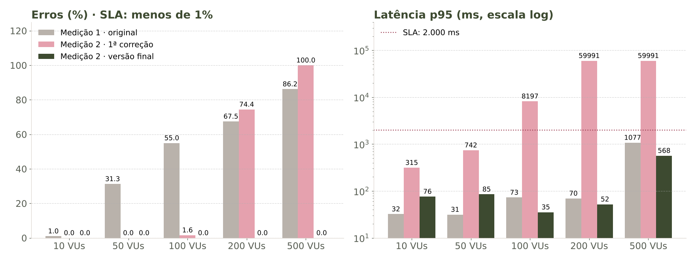

## Metodologia

- **Ferramenta:** k6. Todos os serviços usam o mesmo perfil de carga, definido em [`comum.js`](comum.js).
- **Concorrência:** 10, 50, 100, 200 e 500 usuários virtuais (VUs), com 10 s de subida e 40 s de permanência em cada patamar.
  Cada VU faz uma requisição, aguarda 1 s e repete.
- **Métricas:** latência média, mediana, p95 e p99 (`http_req_duration`), vazão em requisições por segundo, taxa de erros
  (`http_req_failed`) e tempo bloqueado (`http_req_blocked`).
- **SLA:** RNF002 (p95 da latência abaixo de 2 s) e RNF003 (menos de 1% de erros).
  O **limite de concorrência** é o maior patamar em que o SLA ainda é atendido.
- **Massa de dados:** [`massa-de-dados.sql`](massa-de-dados.sql) (2.000 estudantes e 50 eventos) e, para o feed,
  [`massa-feed.sql`](massa-feed.sql) (100 postagens com 3 comentários cada; somadas à carga inicial, 103 postagens).
- **Banco recriado do zero** antes de cada rodada, com as massas de dados carregadas antes dos testes.

### Ambiente

| Item | Configuração (medições 1 e 2) |
| --- | --- |
| Máquina | Notebook Intel Core i5-12450H, 8 GB de RAM, Windows 11 |
| Docker | Docker Desktop |
| Containers | `unilink-mysql`: MySQL 8.0 · `unilink-backend`: Java 21 (eclipse-temurin:21-jre) com Spring Boot 3.5 |
| Pool de conexões | medição 1: HikariCP padrão (10 conexões) · medição 2: 20 conexões |
| Gerador de carga | k6 na mesma máquina, em `http://localhost:8080` |

### Como executar

1. Suba o sistema a partir do repositório principal: `docker compose up -d --build`.
2. Carregue as massas de dados no MySQL (`massa-de-dados.sql` e `massa-feed.sql`).
3. Execute `rodar-testes.bat 2` (Windows) ou `./rodar-testes.sh 2` (Linux ou Mac), informando o número da medição.
4. O script roda o k6 para os quatro serviços e, ao final, executa [`graficos.py`](graficos.py) (requer Python 3 com matplotlib),
   que gera os gráficos e o arquivo `resumo.json` em `resultados/medicao-N/`.

Os arquivos brutos do k6 (`resultados/*/bruto/*.csv`, cerca de 220 MB por medição) não foram versionados, por excederem o limite de tamanho do GitHub.

---

## Serviço 1 · Login

- **Endpoint:** `POST /api/login` (UC02) · **Tipo de operação:** leitura
- **Arquivos envolvidos:** [`EstudanteController.java`](https://github.com/thiagoramos19/unilink-pi2-Amanda-Thiago/blob/main/backend/src/main/java/br/unirio/unilink/controller/EstudanteController.java) · [`EstudanteService.java`](https://github.com/thiagoramos19/unilink-pi2-Amanda-Thiago/blob/main/backend/src/main/java/br/unirio/unilink/service/EstudanteService.java) · [`Senhas.java`](https://github.com/thiagoramos19/unilink-pi2-Amanda-Thiago/blob/main/backend/src/main/java/br/unirio/unilink/service/Senhas.java) · [`EstudanteRepository.java`](https://github.com/thiagoramos19/unilink-pi2-Amanda-Thiago/blob/main/backend/src/main/java/br/unirio/unilink/repository/EstudanteRepository.java)
- **Script de teste:** [`login.js`](login.js)

### Medição 1

- **Data:** 07/11/2026 · **Ambiente:** notebook
- **Requisições:** 42.941 · **Limite de concorrência dentro do SLA:** o SLA foi atendido em todos os patamares, até **500 VUs**

| VUs | Latência média (ms) | p95 (ms) | Vazão (req/s) | Erros (%) | SLA |
| --- | --- | --- | --- | --- | --- |
| 10 | 9,72 | 12,98 | 9,6 | 0,00 | ✅ |
| 50 | 5,87 | 7,66 | 48,5 | 0,00 | ✅ |
| 100 | 5,30 | 7,81 | 97,0 | 0,00 | ✅ |
| 200 | 5,89 | 12,07 | 193,3 | 0,00 | ✅ |
| 500 | 5,90 | 8,79 | 484,9 | 0,00 | ✅ |

Teste inteiro: latência média de 5,70 ms, mediana de 5,26 ms, p95 de 9,38 ms, p99 de 16,16 ms e máxima de 569,28 ms.

### Medição 2

- **Data:** 14/11/2026 · **Ambiente:** notebook
- **Requisições:** 42.977 · **Limite de concorrência dentro do SLA:** o SLA foi atendido em todos os patamares, até **500 VUs**

| VUs | Latência média (ms) | p95 (ms) | Vazão (req/s) | Erros (%) | SLA |
| --- | --- | --- | --- | --- | --- |
| 10 | 7,42 | 9,87 | 9,9 | 0,00 | ✅ |
| 50 | 5,61 | 8,72 | 48,4 | 0,00 | ✅ |
| 100 | 5,00 | 8,54 | 97,0 | 0,00 | ✅ |
| 200 | 4,99 | 7,97 | 194,0 | 0,00 | ✅ |
| 500 | 5,23 | 8,56 | 484,8 | 0,00 | ✅ |

Teste inteiro: latência média de 5,17 ms, mediana de 5,05 ms, p95 de 8,48 ms, p99 de 12,71 ms e máxima de 509,79 ms.

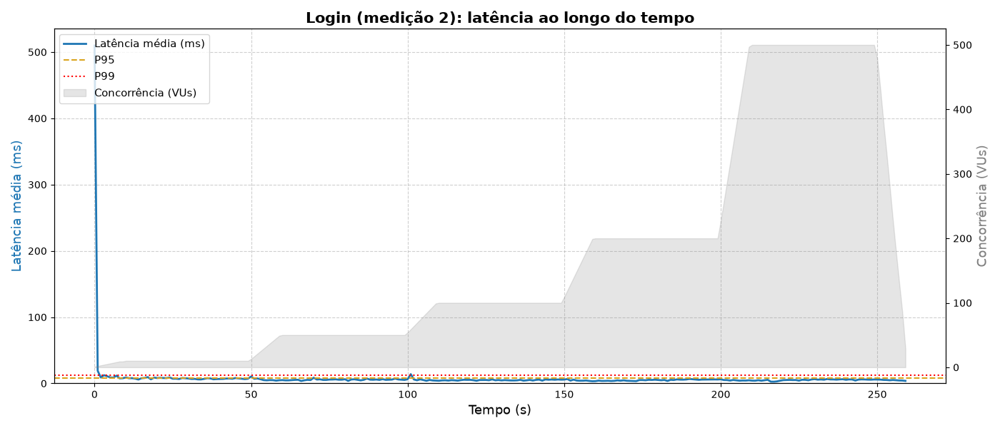
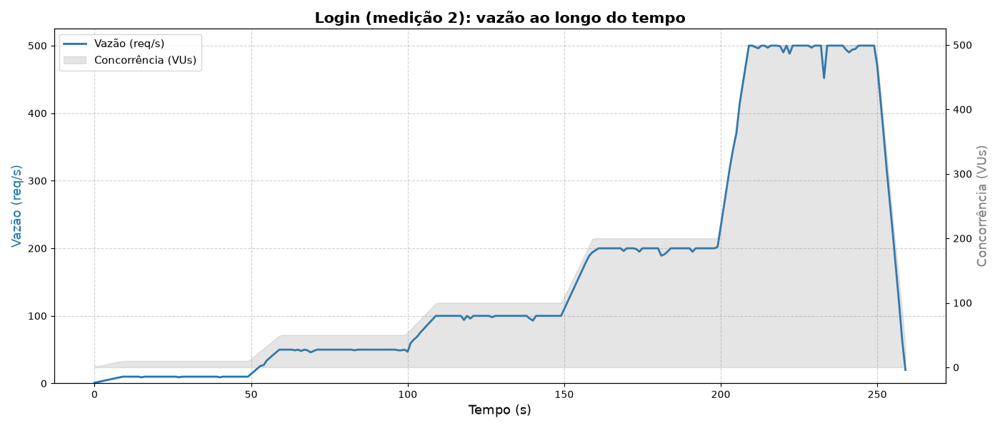
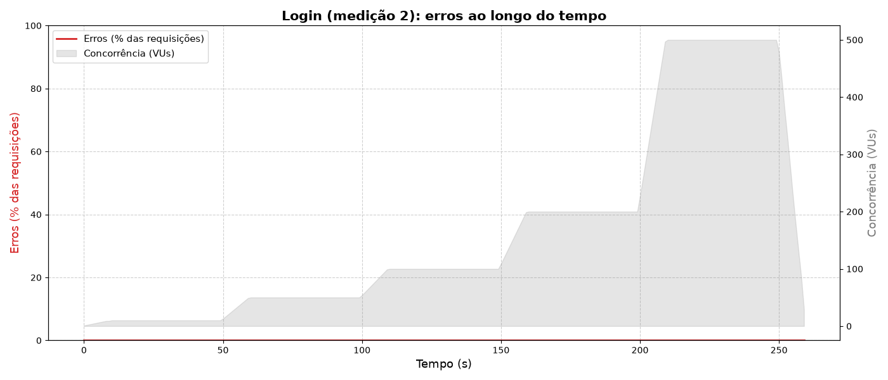
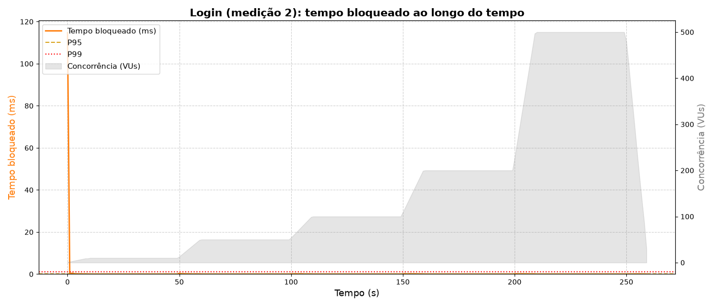

### Comparação e melhorias

O login já respondia em poucos milissegundos e permaneceu assim: o p95 ficou abaixo de 13 ms em todos os patamares das duas medições.
A única alteração que o afeta é o aumento do pool de conexões, comum a todos os serviços ([`application.properties`](https://github.com/thiagoramos19/unilink-pi2-Amanda-Thiago/blob/main/backend/src/main/resources/application.properties)).

---

## Serviço 2 · Agenda de eventos

- **Endpoint:** `GET /api/eventos?email=` (UC06) · **Tipo de operação:** leitura
- **Arquivos envolvidos:** [`EventoController.java`](https://github.com/thiagoramos19/unilink-pi2-Amanda-Thiago/blob/main/backend/src/main/java/br/unirio/unilink/controller/EventoController.java) · [`EventoService.java`](https://github.com/thiagoramos19/unilink-pi2-Amanda-Thiago/blob/main/backend/src/main/java/br/unirio/unilink/service/EventoService.java) · [`EventoRepository.java`](https://github.com/thiagoramos19/unilink-pi2-Amanda-Thiago/blob/main/backend/src/main/java/br/unirio/unilink/repository/EventoRepository.java) · [`01-schema.sql`](https://github.com/thiagoramos19/unilink-pi2-Amanda-Thiago/blob/main/database/01-schema.sql)
- **Script de teste:** [`eventos.js`](eventos.js)

### Medição 1

- **Data:** 07/11/2026 · **Ambiente:** notebook
- **Requisições:** 42.799 · **Limite de concorrência dentro do SLA:** o SLA foi atendido em todos os patamares, até **500 VUs**

| VUs | Latência média (ms) | p95 (ms) | Vazão (req/s) | Erros (%) | SLA |
| --- | --- | --- | --- | --- | --- |
| 10 | 6,63 | 8,58 | 9,7 | 0,00 | ✅ |
| 50 | 6,21 | 8,96 | 48,5 | 0,00 | ✅ |
| 100 | 8,18 | 14,32 | 96,7 | 0,00 | ✅ |
| 200 | 7,99 | 14,23 | 193,4 | 0,00 | ✅ |
| 500 | 10,27 | 22,39 | 483,8 | 0,00 | ✅ |

Teste inteiro: latência média de 9,02 ms, mediana de 7,59 ms, p95 de 18,20 ms, p99 de 34,17 ms e máxima de 111,27 ms.

### Medição 2

- **Data:** 14/11/2026 · **Ambiente:** notebook
- **Requisições:** 35.090 · **Limite de concorrência dentro do SLA:** o SLA foi atendido em todos os patamares, até **500 VUs**

| VUs | Latência média (ms) | p95 (ms) | Vazão (req/s) | Erros (%) | SLA |
| --- | --- | --- | --- | --- | --- |
| 10 | 9,12 | 19,41 | 9,9 | 0,00 | ✅ |
| 50 | 5,75 | 8,96 | 49,8 | 0,00 | ✅ |
| 100 | 6,71 | 11,14 | 99,4 | 0,00 | ✅ |
| 200 | 8,60 | 16,76 | 198,2 | 0,00 | ✅ |
| 500 | 399,05 | 1.575,56 | 349,8 | 0,00 | ✅ |

Teste inteiro: latência média de 231,37 ms, mediana de 8,41 ms, p95 de 1.502,05 ms, p99 de 2.222,20 ms e máxima de 5.118,48 ms.

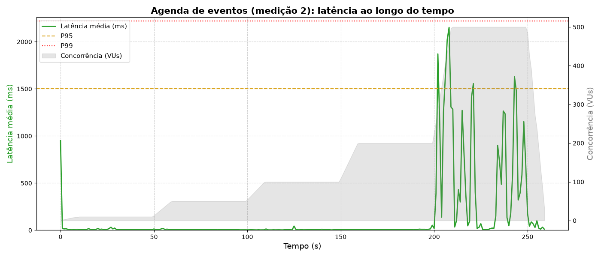
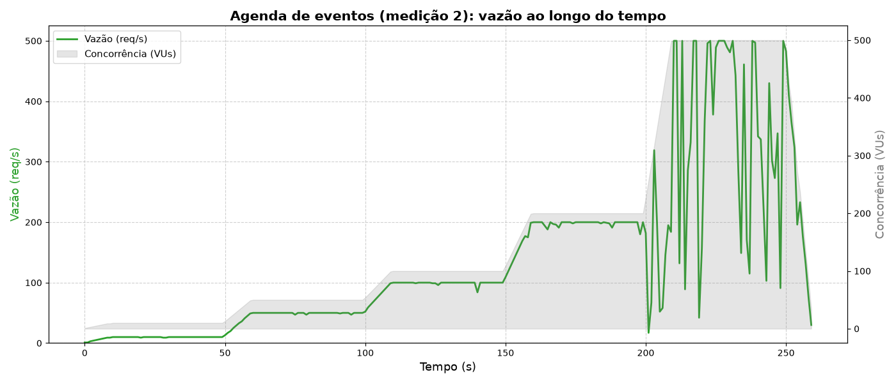

### Comparação e melhorias

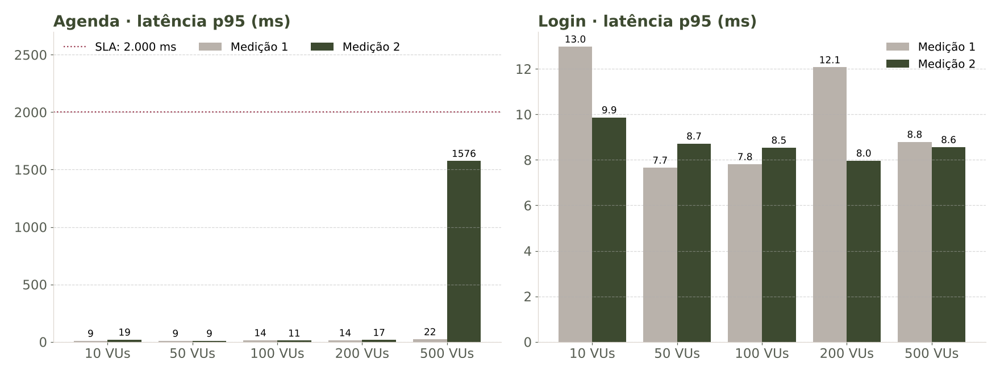

- A subconsulta `EXISTS`, executada para cada evento, foi substituída por um `LEFT JOIN` com `presenca_evento`.
- Foi criado o índice `idx_evento_data` em `evento(data_hora_evento)`, coluna usada na ordenação da agenda.
- Como consequência da melhoria na confirmação de presença (serviço 3), o número de confirmados passou a ser contado em `presenca_evento`
  (`COUNT(*)`) a cada consulta da agenda, em vez de ser lido de uma coluna da tabela `evento`.

Até 200 VUs a agenda manteve o desempenho da medição 1 (p95 entre 9 e 19 ms). Com 500 VUs, a contagem dos confirmados elevou o p95
para 1.576 ms e reduziu a vazão para 350 req/s, ainda dentro do SLA.
Trata-se de uma troca consciente: a escrita deixou de disputar a linha do evento, e o custo foi transferido para a leitura.
O próximo passo indicado é a **paginação da agenda**, que limita a quantidade de eventos contados em cada requisição.

---

## Serviço 3 · Confirmar presença

- **Endpoint:** `POST /api/eventos/{id}/presenca` (UC06) · **Tipo de operação:** inserção
- **Arquivos envolvidos:** [`EventoController.java`](https://github.com/thiagoramos19/unilink-pi2-Amanda-Thiago/blob/main/backend/src/main/java/br/unirio/unilink/controller/EventoController.java) · [`EventoService.java`](https://github.com/thiagoramos19/unilink-pi2-Amanda-Thiago/blob/main/backend/src/main/java/br/unirio/unilink/service/EventoService.java) · [`EventoRepository.java`](https://github.com/thiagoramos19/unilink-pi2-Amanda-Thiago/blob/main/backend/src/main/java/br/unirio/unilink/repository/EventoRepository.java) · [`Validacao.java`](https://github.com/thiagoramos19/unilink-pi2-Amanda-Thiago/blob/main/backend/src/main/java/br/unirio/unilink/service/Validacao.java) · [`01-schema.sql`](https://github.com/thiagoramos19/unilink-pi2-Amanda-Thiago/blob/main/database/01-schema.sql)
- **Script de teste:** [`presenca.js`](presenca.js)

### Medição 1 · código original

- **Data:** 07/11/2026 · **Ambiente:** notebook
- **Requisições:** 35.716 · **Limite de concorrência dentro do SLA:** o SLA não foi atendido já no primeiro patamar (10 VUs)

| VUs | Latência média (ms) | p95 (ms) | Vazão (req/s) | Erros (%) | SLA |
| --- | --- | --- | --- | --- | --- |
| 10 | 23,13 | 32,20 | 9,5 | 1,02 | ❌ |
| 50 | 18,62 | 31,49 | 48,0 | 31,27 | ❌ |
| 100 | 39,93 | 72,81 | 93,7 | 54,97 | ❌ |
| 200 | 33,54 | 69,54 | 188,0 | 67,48 | ❌ |
| 500 | 439,40 | 1.077,32 | 328,0 | 86,19 | ❌ |

Teste inteiro: latência média de 204,88 ms, mediana de 44,13 ms, p95 de 859,09 ms, p99 de 1.336,64 ms e máxima de 3.082,39 ms.

### Medição 2 · primeira correção

- **Data:** 14/11/2026 · **Ambiente:** notebook · **Código:** primeira correção (UPDATE antes do INSERT)
- **Requisições:** 5.784 · **Limite de concorrência dentro do SLA:** **50 VUs**; com 100 VUs o SLA deixa de ser atendido

| VUs | Latência média (ms) | p95 (ms) | Vazão (req/s) | Erros (%) | SLA |
| --- | --- | --- | --- | --- | --- |
| 10 | 110,89 | 314,51 | 8,8 | 0,00 | ✅ |
| 50 | 130,34 | 742,02 | 43,2 | 0,00 | ✅ |
| 100 | 2.645,42 | 8.197,50 | 19,3 | 1,59 | ❌ |
| 200 | 48.021,37 | 59.991,36 | 1,9 | 74,42 | ❌ |
| 500 | 56.189,58 | 59.991,42 | 4,5 | 100,00 | ❌ |

Teste inteiro: latência média de 7.159,68 ms, mediana de 54,89 ms, p95 de 59.990,33 ms, p99 de 59.991,40 ms e máxima de 60.740,22 ms.

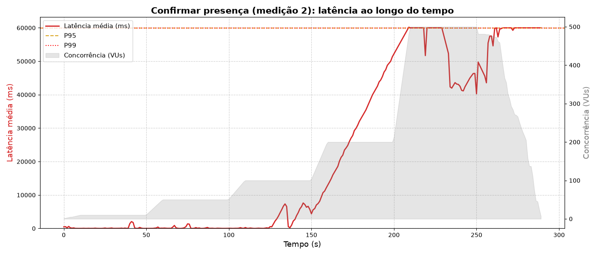
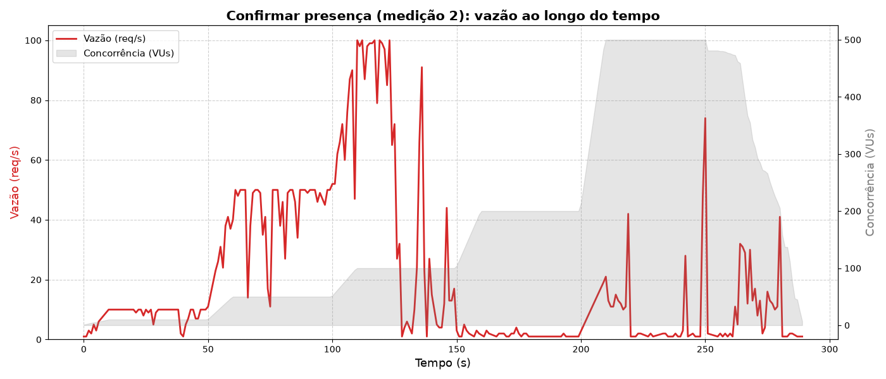
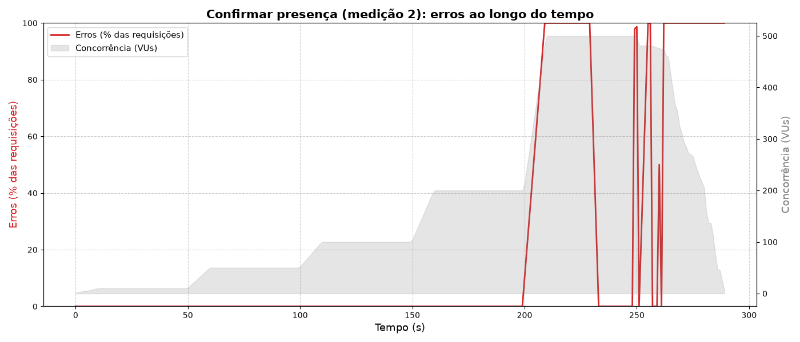
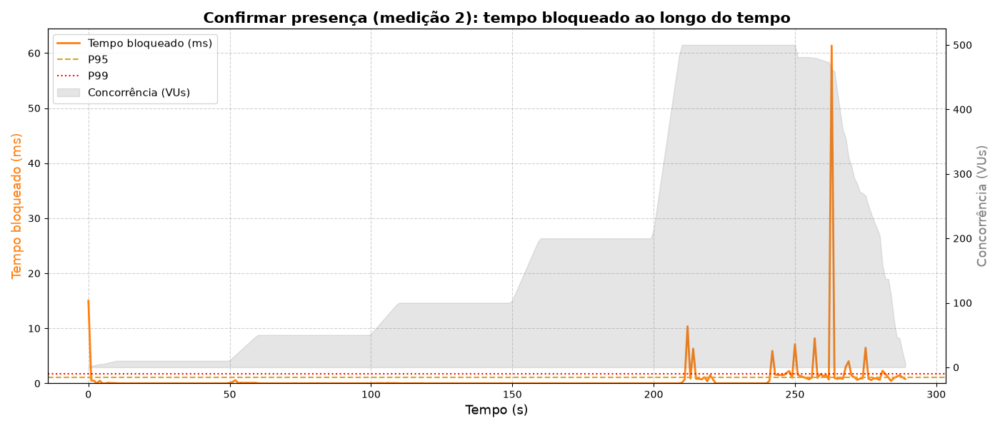

### Medição 2 · versão final

- **Data:** 14/11/2026 · **Ambiente:** notebook · **Código:** versão final (somente INSERT)
- **Requisições:** 40.016 · **Limite de concorrência dentro do SLA:** o SLA foi atendido em todos os patamares, até **500 VUs**

| VUs | Latência média (ms) | p95 (ms) | Vazão (req/s) | Erros (%) | SLA |
| --- | --- | --- | --- | --- | --- |
| 10 | 19,52 | 76,14 | 9,5 | 0,00 | ✅ |
| 50 | 21,66 | 85,22 | 47,8 | 0,00 | ✅ |
| 100 | 16,03 | 35,42 | 95,6 | 0,00 | ✅ |
| 200 | 28,08 | 52,23 | 189,4 | 0,00 | ✅ |
| 500 | 145,16 | 568,00 | 417,0 | 0,00 | ✅ |

Teste inteiro: latência média de 79,47 ms, mediana de 22,52 ms, p95 de 365,53 ms, p99 de 776,60 ms e máxima de 5.793,31 ms.

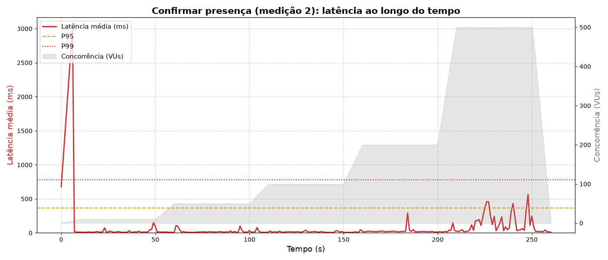
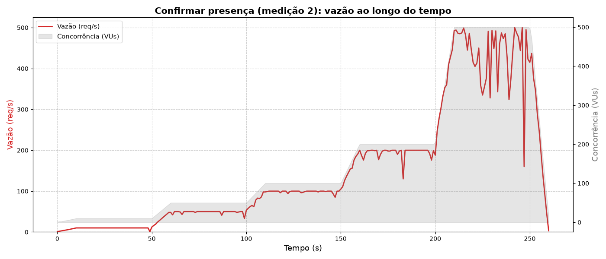
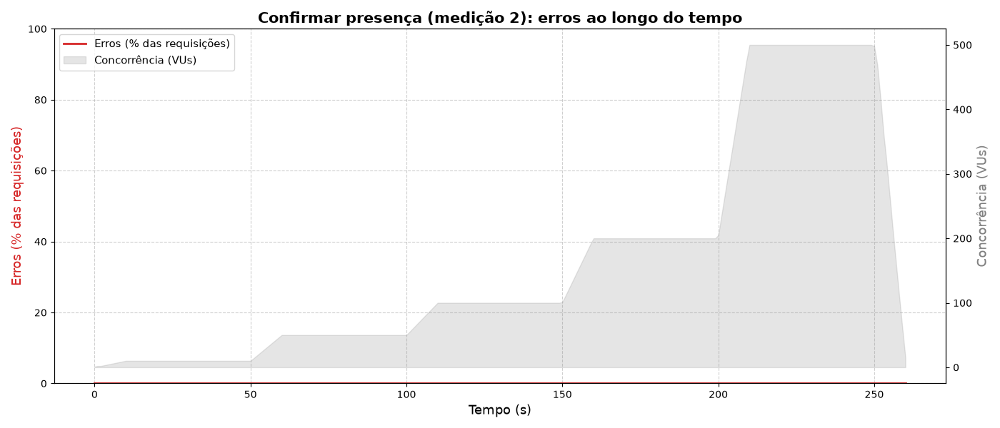
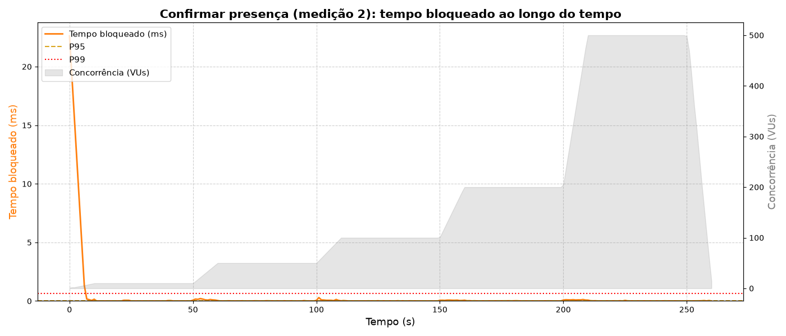

### Comparação e melhorias

1. **Código original:** a mesma transação inseria a presença em `presenca_evento` e depois incrementava o contador `qtd_confirmados` em `evento`.
   A verificação da chave estrangeira no `INSERT` obtém um bloqueio compartilhado na linha do evento, e o `UPDATE` solicita um bloqueio
   exclusivo na mesma linha. Com requisições simultâneas para o mesmo evento, ocorria *deadlock* e o MySQL abortava uma das transações.
2. **Primeira correção:** a ordem foi invertida (primeiro o `UPDATE`, depois o `INSERT`). O *deadlock* foi eliminado, mas todas as confirmações
   do mesmo evento passaram a aguardar a liberação da mesma linha. Até 50 VUs não houve erros; a partir de 100 VUs a fila cresceu,
   com requisições esperando até 60 s e 100% de erros com 500 VUs.
3. **Versão final:** confirmar presença executa apenas o `INSERT` em `presenca_evento`, sem transação explícita, e o número de confirmados
   passou a ser calculado por contagem nessa tabela. Nenhuma requisição escreve na linha do evento. A chave primária composta impede a presença
   repetida (HTTP 409) e a chave estrangeira impede o estudante inexistente (HTTP 400).

Resultado: zero erros em todos os patamares, p95 de 568 ms com 500 VUs (antes, 1.077 ms)
e limite de concorrência dentro do SLA de **500 VUs ou mais** (antes, menos de 10 VUs).

---

## Serviço 4 · Feed

- **Endpoint:** `GET /api/postagens` (UC08) · **Tipo de operação:** leitura
- **Arquivos envolvidos:** [`PostagemController.java`](https://github.com/thiagoramos19/unilink-pi2-Amanda-Thiago/blob/main/backend/src/main/java/br/unirio/unilink/controller/PostagemController.java) · [`PostagemService.java`](https://github.com/thiagoramos19/unilink-pi2-Amanda-Thiago/blob/main/backend/src/main/java/br/unirio/unilink/service/PostagemService.java) · [`PostagemRepository.java`](https://github.com/thiagoramos19/unilink-pi2-Amanda-Thiago/blob/main/backend/src/main/java/br/unirio/unilink/repository/PostagemRepository.java)
- **Script de teste:** [`feed.js`](feed.js)

O feed foi incluído na medição 2 e, por isso, não possui medição 1.

### Medição 2

- **Data:** 14/11/2026 · **Ambiente:** notebook
- **Requisições:** 41.806 · **Limite de concorrência dentro do SLA:** o SLA foi atendido em todos os patamares, até **500 VUs**

| VUs | Latência média (ms) | p95 (ms) | Vazão (req/s) | Erros (%) | SLA |
| --- | --- | --- | --- | --- | --- |
| 10 | 18,34 | 64,61 | 9,7 | 0,00 | ✅ |
| 50 | 18,68 | 57,84 | 47,9 | 0,00 | ✅ |
| 100 | 23,69 | 56,48 | 94,9 | 0,00 | ✅ |
| 200 | 17,19 | 43,90 | 191,8 | 0,00 | ✅ |
| 500 | 49,90 | 221,53 | 463,5 | 0,00 | ✅ |

Teste inteiro: latência média de 33,77 ms, mediana de 13,77 ms, p95 de 157,28 ms, p99 de 300,89 ms e máxima de 5.936,64 ms.

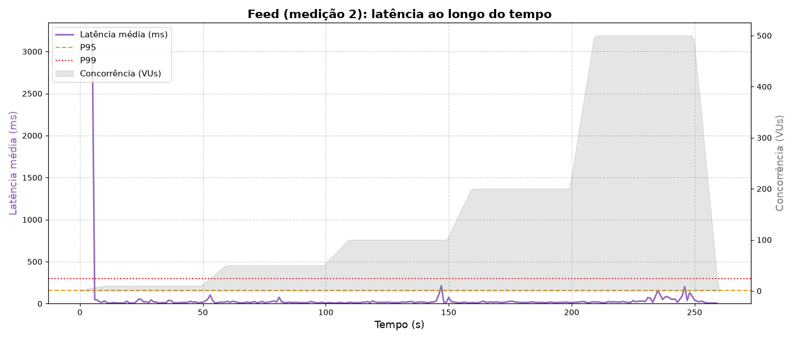
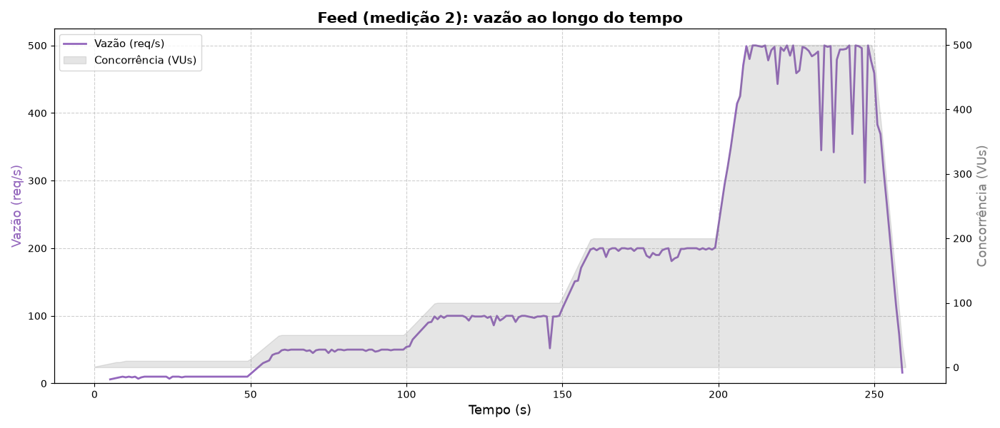

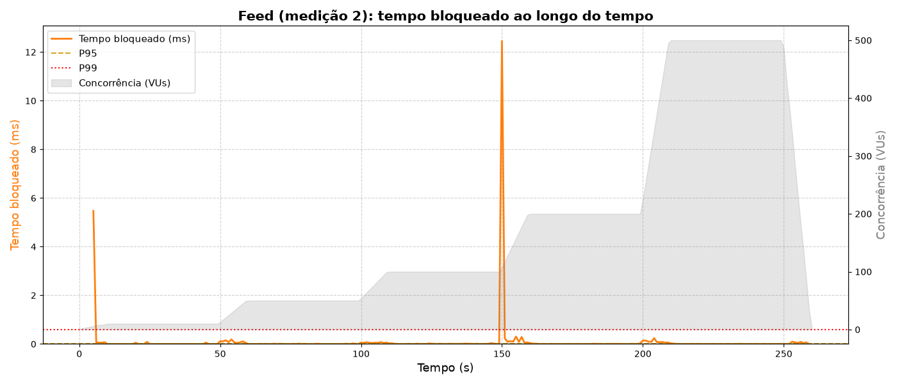

### Comparação e melhorias

O feed apresentava o problema **N+1**: após buscar as postagens, o sistema executava uma consulta de comentários para cada postagem.
Com as 103 postagens do teste, eram 104 consultas por requisição. Na versão otimizada, todos os comentários são obtidos em uma única consulta
e agrupados por postagem em Java, totalizando **2 consultas por requisição**.

A comparação entre o código original e o otimizado do feed foi feita em uma máquina virtual Linux na nuvem (4 vCPUs, 15 GB de RAM),
com o mesmo roteiro: o p95 com 500 VUs caiu de 4.735 ms (fora do SLA a partir de 500 VUs) para 12 ms, e a vazão subiu de 96 para 485 req/s.

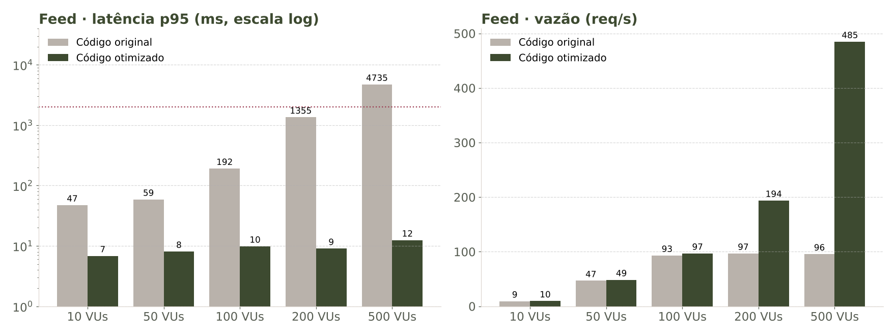

---

## Visão geral da medição 2

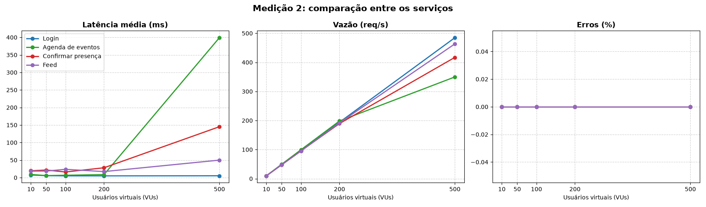

## Arquivos

| Arquivo | Conteúdo |
| --- | --- |
| [`comum.js`](comum.js) | Perfil de carga compartilhado (patamares e limites do SLA) |
| [`login.js`](login.js) · [`eventos.js`](eventos.js) · [`presenca.js`](presenca.js) · [`feed.js`](feed.js) | Scripts k6 de cada serviço |
| [`massa-de-dados.sql`](massa-de-dados.sql) · [`massa-feed.sql`](massa-feed.sql) | Massas de dados |
| [`rodar-testes.bat`](rodar-testes.bat) · [`rodar-testes.sh`](rodar-testes.sh) | Execução de todos os testes |
| [`graficos.py`](graficos.py) | Geração dos gráficos e dos resumos |
| [`resultados/medicao-1/`](resultados/medicao-1) | Resumo da medição 1 |
| [`resultados/medicao-2/`](resultados/medicao-2) | Resultados, resumos do k6 e gráficos da medição 2 (versão final) |
| [`resultados/medicao-2-primeira-correcao/`](resultados/medicao-2-primeira-correcao) | Agenda e confirmação de presença com a primeira correção |
